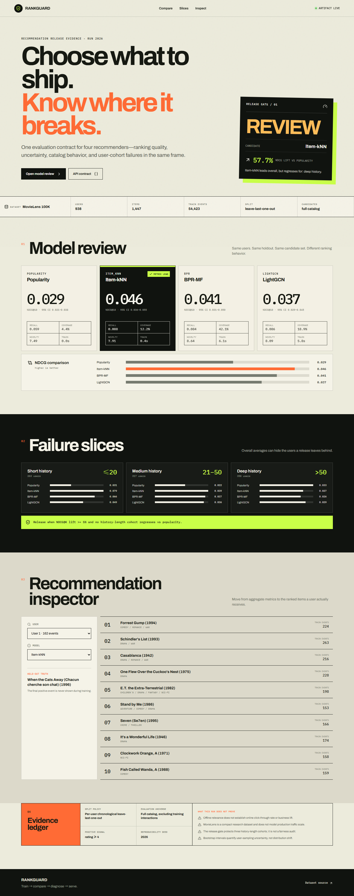
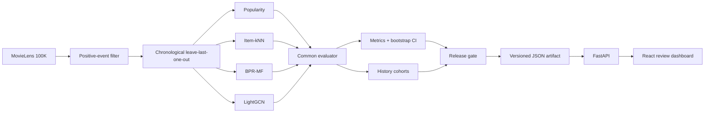

<div align="center">

# RankGuard

### Train → compare → diagnose → serve.

An evidence-first recommendation evaluation and serving workbench built with
PyTorch, FastAPI, React, and TypeScript.

</div>



## Why this project exists

A recommender can improve an average metric while failing an important user group. RankGuard puts
four models behind one evaluation contract, then asks a release question: **which model should ship,
for which users, and with what evidence?**

The default run uses real MovieLens 100K interactions, a chronological per-user holdout, full-catalog
ranking, bootstrap confidence intervals, and three history-length cohorts. The result is served through
a typed API and an interactive review dashboard.

## Verified result

The checked-in artifact was produced with seed `2026` on 938 eligible users, 1,447 items, and 54,423
training interactions. Ratings of at least 4 are treated as positive events; each user's final positive
event is held out for testing.

| Model | NDCG@10 | Recall@10 | Catalog coverage@10 | Novelty@10 | Train time |
|---|---:|---:|---:|---:|---:|
| Popularity | 0.0290 | 0.0586 | 4.4% | 7.49 | 0.0 s |
| **Item-kNN** | **0.0457** | **0.0885** | 12.2% | 7.91 | 0.4 s |
| BPR-MF | 0.0408 | 0.0842 | **42.1%** | **8.64** | 6.1 s |
| LightGCN | 0.0367 | 0.0864 | 18.9% | 8.09 | 5.8 s |

**Release decision: `REVIEW`.** Item-kNN improves overall NDCG@10 by 57.7% over the popularity
baseline, but its NDCG@10 falls from 0.0335 to 0.0272 for users with more than 50 training events.
RankGuard therefore refuses an automatic release. This is the central result: the newest model does
not automatically win, and the global winner is not automatically safe for every cohort.

## What the repository demonstrates

- **Recommendation algorithms:** popularity, item-kNN, BPR matrix factorization, and LightGCN.
- **Evaluation rigor:** chronological split, no train/test leakage, full-catalog ranking, Recall@K,
  NDCG@K, MRR, coverage, novelty, long-tail share, and user-bootstrap intervals.
- **Failure analysis:** short-, medium-, and deep-history user cohorts with an explicit release gate.
- **ML engineering:** deterministic config, versioned experiment artifacts, FastAPI endpoints,
  React/TypeScript UI, tests, Docker, and CI.
- **Product judgment:** an inspectable user-level recommendation view and honest evidence limits.

## Architecture



## Run locally

Requirements: Python 3.11–3.13, Node.js 20+, and `uv`. A GPU is optional; the verified run completes
comfortably on CPU.

```bash
uv sync --python 3.12 --extra dev
uv run rankguard-train --device cpu
cd frontend
npm install
npm run build
cd ..
uv run rankguard-api
```

Open <http://localhost:8000>. Interactive API documentation is at
<http://localhost:8000/docs>.

For a faster smoke run:

```bash
uv run rankguard-train --quick --device cpu
```

Or run the checked-in artifact with Docker:

```bash
docker compose up --build
```

## API surface

| Endpoint | Purpose |
|---|---|
| `GET /api/experiment` | Dataset contract, metrics, intervals, cohorts, and limitations |
| `GET /api/models` | Comparable model result records |
| `GET /api/release` | Candidate, decision, guardrail failures, and release rule |
| `GET /api/users` | Evaluated user summaries |
| `GET /api/users/{id}/recommendations` | Ranked items for one user and model |
| `GET /docs` | OpenAPI explorer |

## Repository map

```text
src/rankguard/          training, models, evaluation, artifacts, API
frontend/               React + TypeScript review dashboard
artifacts/latest/       reproducible checked-in evaluation output
tests/                  metric, release-gate, API, and browser tests
docs/                   data card, model card, screenshots, interview guide
```

## Verification

```bash
uv run ruff check .
uv run pytest --cov=rankguard --cov-report=term-missing --cov-fail-under=70 -q
cd frontend && npm run build
```

The browser test exercises the real built dashboard at desktop and mobile widths, checks the model
cards and recommendation rows, records screenshots, and rejects horizontal overflow or console errors.

## Evidence boundary

Offline ranking results do not establish online click-through rate or business lift. MovieLens is a
compact research dataset, bootstrap intervals capture user-sampling uncertainty only, and the included
history cohorts are not a fairness audit. See the [data card](docs/data_card.md) and
[model card](docs/model_card.md) for the full scope. A ready-to-use project pitch and bilingual CV
bullets are available in the [interview guide](docs/interview_guide.md) and
[resume bullets](docs/resume_bullets.md).

## License

Code is released under the MIT License. MovieLens data is downloaded from GroupLens at runtime and is
not redistributed.
